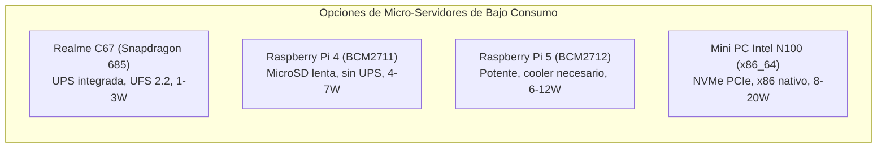

# Análisis de Hardware y Equipos Comparables: C67 DB+NAS

Este documento analiza el perfil técnico del **Realme C67 (Snapdragon 685)** utilizado como servidor de base de datos relacional y almacenamiento en red, y lo compara con dispositivos equivalentes del mercado: smartphones de arquitectura semejante, placas de desarrollo (SBCs) y mini PCs de bajo consumo.

---

## 1. Ficha Técnica del Dispositivo Base: Realme C67

| Componente | Especificación Técnica | Relevancia para Servidor / Base de Datos |
|---|---|---|
| **SoC** | Qualcomm Snapdragon 685 (SM6225-AD, 6nm TSMC) | Proceso litográfico moderno, bajísima emisión térmica y consumo reducido. |
| **CPU** | Octa-core: 4x Cortex-A73 @ 2.80 GHz + 4x Cortex-A53 @ 1.90 GHz | 4 núcleos de alto rendimiento para consultas SQL complejas + 4 de eficiencia para el supervisor y la API HTTP. |
| **Memoria RAM** | 6 GB / 8 GB LPDDR4X (dual-channel @ 2133 MHz) | Suficiente para albergar `shared_buffers = 128MB` a `1GB` y cientos de conexiones concurrentes en memoria. |
| **Almacenamiento** | 128 GB / 256 GB UFS 2.2 | **Punto crítico:** ~500 MB/s lectura secuencial, ~250 MB/s escritura secuencial y ~45.000 IOPS aleatorias. Muy superior a tarjetas MicroSD. |
| **Batería** | 5.000 mAh Li-Po (~19.25 Wh) | Funciona como **SAI / UPS integrado** con tiempo de conmutación 0 ms ante cortes de luz (autonomía ~14 a 24 horas como servidor). |
| **Conectividad** | Wi-Fi 5 (802.11ac 2.4/5 GHz), 4G LTE Cat 13, Bluetooth 5.0, USB-C 2.0 (OTG) | Capacidad de red dual: Wi-Fi local + failover con datos móviles 4G si cae la conexión de fibra. |
| **Consumo** | ~0.6W - 1.2W en reposo (idle); ~3.0W - 4.5W bajo carga continua | Coste eléctrico prácticamente insignificante: menos de \$2 a \$4 USD al año en funcionamiento 24/7. |

---

## 2. Categoría 1: Smartphones Android Compatibles Directos

Cualquier teléfono inteligente con especificaciones similares y arquitectura **arm64-v8a** puede ejecutar exactamente este mismo APK (`c67-db-nas`) sin modificaciones de código:

### A. Misma Plataforma (Snapdragon 685 / Snapdragon 680 - 6nm)
Comparten la misma arquitectura de CPU (Kryo 265 / Cortex-A73 + A53) y controlador de almacenamiento UFS 2.2:
- **Xiaomi Redmi Note 12 4G / Redmi Note 13 4G**: Snapdragon 685, 6/8 GB RAM, 5000 mAh. Rendimiento 100% idéntico al Realme C67.
- **Motorola Moto G52 / Moto G32**: Snapdragon 680 (reloj CPU ligeramente inferior: 2.4 GHz vs 2.8 GHz), 4/6 GB RAM, UFS 2.2.
- **Honor X7b / X8b**: Snapdragon 680 / 685, 6/8 GB RAM.
- **Realme 9 4G**: Snapdragon 680, 6/8 GB RAM.

### B. Plataformas de Arquitectura Superior (MediaTek Helio G99 - 6nm)
Cuentan con núcleos más modernos (**Cortex-A76**), ofreciendo entre un **25% y 35% más de rendimiento en consultas SQL monohilo (OLTP)**:
- **Samsung Galaxy A15 4G / Galaxy A24**: Helio G99 (2x Cortex-A76 @ 2.2 GHz + 6x Cortex-A55 @ 2.0 GHz), 4/6/8 GB RAM, almacenamiento UFS 2.2.
- **Xiaomi Poco M5 / Redmi Note 13 Pro 4G**: Helio G99 / G99-Ultra, 6/8 GB RAM.
- **Motorola Moto G72 / G54**: Helio G99 / Dimensity 7020.
- **Tecno Camon 20 Pro / Infinix Note 30**: Helio G99, 8 GB RAM.

---

## 3. Categoría 2: Comparativa con SBCs y Servidores Dedicados

Tradicionalmente, para un servidor casero o de borde (Edge Computing) de PostgreSQL y NAS se recurre a placas de desarrollo (SBCs) o Mini PCs x86. A continuación se analiza la comparativa directa frente al smartphone:

### 1. Frente a Raspberry Pi 4 Model B (4 GB / 8 GB)
- **Rendimiento I/O (Disco):** El almacenamiento **UFS 2.2** del Realme C67 (~500 MB/s) supera por un factor de 5x a 8x a una tarjeta MicroSD estándar en una Raspberry Pi 4 (~40-80 MB/s). En bases de datos relacionales como PostgreSQL, las operaciones de `fsync`, escrituras WAL (Write-Ahead Logging) y checkpoints saturan rápidamente las tarjetas SD, provocando cuellos de botella e incluso degradación física prematura de la tarjeta.
- **Eficiencia y Litografía:** El Snapdragon 685 está fabricado en **6nm**, frente a los **28nm** de la Raspberry Pi 4. Esto resulta en la mitad de consumo eléctrico y menor disipación térmica.
- **Ventaja de la Pi 4:** Dispone de puerto Ethernet Gigabit nativo RJ45 y puertos USB 3.0 para discos duros externos sin adaptadores.

### 2. Frente a Raspberry Pi 5 (4 GB / 8 GB)
- **Potencia de Cálculo:** La Raspberry Pi 5 (4x Cortex-A76 @ 2.4 GHz, 16nm) es superior en cómputo bruto monohilo frente a los Cortex-A73 del C67.
- **Coste y Accesorios:** Una Raspberry Pi 5 funcional requiere: placa (\$60-\$80), fuente oficial 27W (\$15), disipador activo (\$7), almacenamiento SSD NVMe + HAT M.2 (\$40-\$60) y un SAI externo (\$40-\$80). La inversión total supera los **\$160 - \$220 USD**.
- **El smartphone:** Integra pantalla táctil para diagnósticos, batería de respaldo y almacenamiento rápido en una sola unidad compacta.

### 3. Frente a Mini PC x86 Intel N100 (ej. Beelink S12 Pro / GMKtec G3)
- **Ecosistema x86:** El Intel N100 (4 cores @ 3.4 GHz, 6W-15W TDP) admite Linux nativo (Debian, Ubuntu), Docker sin emulaciones y discos NVMe Gen3x4 (>2.000 MB/s).
- **Consumo:** Un Mini PC N100 consume en reposo unos 6W-9W y bajo carga 18W-25W. El Realme C67 consume entre 4 y 6 veces menos energía.
- **Tolerancia a fallos:** El Mini PC se apaga instantáneamente ante un corte eléctrico si no se cuenta con un SAI externo voluminoso.

---

## 4. Matriz Comparativa Global

| Parámetro | Realme C67 (Snapdragon 685) | Raspberry Pi 4 (8GB + MicroSD) | Raspberry Pi 5 (8GB + NVMe) | Mini PC Intel N100 (8GB + NVMe) |
|:---|:---:|:---:|:---:|:---:|
| **Arquitectura** | ARM64 (`arm64-v8a`) | ARM64 (`aarch64`) | ARM64 (`aarch64`) | x86_64 |
| **Núcleos CPU** | 4x A73 (2.8 GHz) + 4x A53 (1.9 GHz) | 4x A72 (1.8 GHz) | 4x A76 (2.4 GHz) | 4x Alder Lake-N (3.4 GHz) |
| **Proceso (Litografía)** | **6 nm TSMC** | 28 nm | 16 nm | Intel 7 (10 nm) |
| **Velocidad Almacenamiento** | **~500 MB/s (UFS 2.2)** | ~40-80 MB/s (MicroSD) | ~800 MB/s (PCIe 2.0 x1) | >2.000 MB/s (PCIe 3.0 x4) |
| **Resistencia a Escritura DB** | **Alta (Controlador UFS)** | Muy Baja (Corrupción fácil SD) | Muy Alta (SSD NVMe) | Muy Alta (SSD NVMe) |
| **SAI / Batería de Respaldo** | **Integrada (5000 mAh / ~18h)** | No (Requiere accesorio) | No (Requiere accesorio) | No (Requiere SAI 220V) |
| **Consumo en Reposo (Idle)** | **0.8 W** | 3.5 W | 4.8 W | 6.5 W |
| **Consumo Máximo (Carga)** | **4.2 W** | 7.6 W | 12.0 W | 22.0 W |
| **Coste Eléctrico Anual (USD)**| **~$1.5 - $3.0** | ~$6.0 - $11.0 | ~$9.0 - $18.0 | ~$15.0 - $35.0 |
| **Conectividad de Red** | Wi-Fi 5 + 4G LTE Backup | Gigabit Ethernet + Wi-Fi 5 | Gigabit Ethernet + Wi-Fi 5 | 2.5 GbE Ethernet + Wi-Fi 6 |
| **Pantalla de Diagnóstico** | **Sí (Táctil 6.72" FHD+)** | No (HDMI externo) | No (HDMI externo) | No (HDMI externo) |
| **Refrigeración** | Pasiva (0 dB, silencioso) | Ventilador recomendado | Ventilador obligatorio | Ventilador activo |

---

## 5. Ventajas Estratégicas del Smartphone como Servidor

1. **UPS de Grado Médico sin Coste Adicional:**
   La batería interna de 5.000 mAh conmuta sin fluctuaciones de voltaje ante cualquier apagón, protegiendo las tablas y los archivos de transacción WAL de PostgreSQL contra corrupciones de escritura.
2. **Red de Respaldo Celular (Failover WAN):**
   Con una tarjeta SIM o eSIM, el servidor puede mantenerse accesible a través de VPNs como Tailscale o WireGuard incluso si se corta el suministro de fibra óptica o el router local queda sin energía.
3. **Consola y Diagnóstico In-Situ:**
   Al disponer de panel táctil integrado, es posible comprobar el estado del servicio, las IPs asignadas, los logs de logcat o reiniciar los servicios directamente tocando la pantalla, sin requerir monitor HDMI, teclado USB ni acceso SSH inicial.
4. **Huella Físico-Acústica Inexistente:**
   Cero decibelios (0 dB) y dimensiones mínimas que permiten ubicarlo en cualquier rincón, estantería o armario de comunicaciones.

---

## 6. Recomendaciones de Dimensionamiento para PostgreSQL en C67

- **Carga recomendada:** Aplicaciones web/móviles ligeras, sistemas ERP/CRM para pequeñas empresas (1 a 20 usuarios activos concurrentes), bases de datos para domótica (Home Assistant, Node-RED, sensores IoT) y sincronización de datos Edge.
- **Configuración óptima de PostgreSQL (`postgresql.conf`):**
  - `max_connections = 50` a `100`
  - `shared_buffers = 128MB` a `256MB`
  - `effective_cache_size = 512MB` a `1GB`
  - `work_mem = 4MB`
  - `maintenance_work_mem = 64MB`
  - `wal_buffers = 16MB`
- **Refrigeración Térmica:** Retirar la funda protectora de plástico/silicona si el teléfono va a operar con cargas continuas intensas de lectura/escritura y mantener la pantalla apagada (el servicio opera en segundo plano con WakeLock de CPU).
